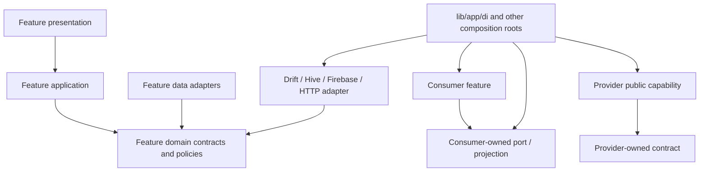
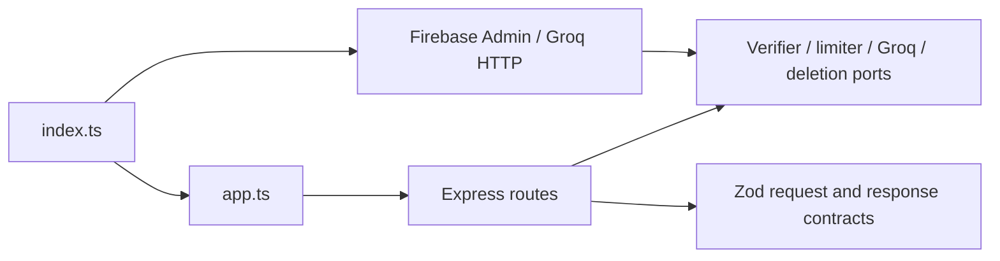

# Dependency Direction

## Dart application

An arrow means “may depend on.” Domain has no inward dependency on framework or
outer layers. Application-facing APIs must not expose Drift rows, Firebase user
types, Hive boxes or `BuildContext`.

## Cross-feature calls

Contract ownership follows the reason for change, not a blanket rule:

1. When a feature deliberately offers a stable capability, that provider owns
   the pure public contract and its facade. Auth session/restoration contracts,
   `TransactionRowDomainMapper`, and `ReceiptImageCleanupPort` follow this form.
2. When only the consumer needs a narrow view or optional service, the consumer
   owns the port/projection. The providing feature must not import that consumer
   contract merely to wire itself.
3. Adapt provider output to a consumer-owned contract in an outer composition
   root. For example, Goals owns `GoalLinkedAccountOption`, while
   `lib/app/di/goal_linked_accounts_composition.dart` projects the Accounts read
   model. Insights owns its explanation port; the AI-side adapter implements it
   without moving provider-specific types into Insights.
4. Export only the symbols required by callers, inject the implementation from
   Riverpod/app composition, and keep private paths private.

`lib/app/di` is the cross-feature Riverpod composition root for bindings such as
financial Insights inputs and Goals linked-account projections. It may import
both sides of a binding; neither feature may import `lib/app/di` as a place to
store business rules. Compatibility re-exports exist only where source
compatibility and provider identity are intentional.

## Owner-scoped dependencies

Owner-aware providers must derive their scope from the current Auth owner-scope
provider. They must invalidate or rebuild on owner transitions and fence stale
asynchronous results. Repositories still validate owner scope and referenced
entities; a provider-selected ID is not authorization.

## Persistence boundary

Drift table rows and generated companions remain in data/infrastructure. Shared
read models receive mapper contracts instead of importing another feature's
private DTO mapper. `AppDatabase` owns schema and connection-level guards; its
cohesive behaviors are split into six private compile-time `part` extensions.
Public methods, schema 17, transaction boundaries, DDL/SQL text and execution
order remain owned by the same library and are compatibility contracts.

## Gateway

Only the composition root constructs concrete adapters. Routes receive narrow
dependency views. Provider parsing, bounded reads, SSE decoding, request
lifecycle and deletion policies are separate capabilities. Provider models and
tool allowlists remain server-selected.

## Known cycle debt

Public facades remove private-layer violations but do not automatically remove
feature-level cycles. The current cycle graph is recorded in
`test/architecture/feature_dependency_cycle_test.dart`: one 9-feature strongly
connected component with 31 exact directed edges, down from 13/48 when the guard
was introduced. The strict private/layer edge baseline is independently zero.
Do not route a new dependency through `core` or a facade merely to hide a cycle.
Remove it only by finding the true stable owner of a contract or by moving
composition upward to `lib/app/di`.
